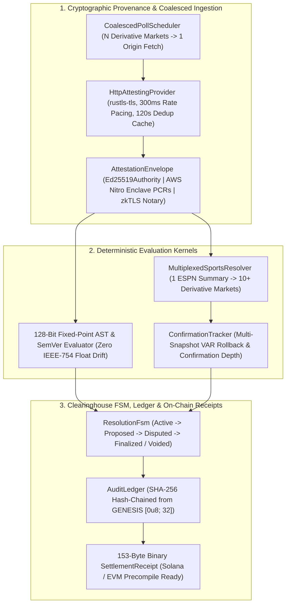

# Resolution-as-a-Service (RaaS) — Verifiable Oracle & Clearinghouse Engine

An institutional-grade, cryptographically verifiable **Resolution-as-a-Service (RaaS)** engine built in Rust for prediction markets, sportsbooks, and decentralized clearinghouses (Polymarket, Kalshi, SX Bet, Octopus).

Unlike conventional scraper services that mutate database rows (`UPDATE markets SET status = 'resolved'`) over unverified HTTP responses, this engine treats every market settlement as a **deterministic mathematical proof over signed wire bytes**. Every resolution produces a portable `AttestedPayload`, an append-only hash-chained `AuditLedger` trail, and a **153-byte binary-deterministic `SettlementReceipt`** verifiable by an air-gapped client or on-chain smart contract (Solana `ed25519_program` / EVM `reportPayouts`) with **zero database or network dependencies**.

---

## 1. System Architecture



---

## 2. Core Guarantees & Institutional Guards

### 2.1 Cryptographic Byte Provenance (`src/provenance/`)
Every outbound HTTPS fetch is captured as an [`AttestedPayload`](src/provenance/mod.rs) containing:
- `raw_bytes`: Exact wire response body bytes.
- `payload_sha256`: `SHA-256(raw_bytes)`.
- `canonical_headers`: Lowercase, lexicographically sorted HTTP headers (`content-type`, `date`, `etag`, `last-modified`, `cache-control`).
- `commitment_hash()`:
  $$\text{SHA-256}(\texttt{"RESOLUTION\_SERVICE\_ATTESTATION\_V1:"} \parallel \text{url} \parallel \text{timestamp}_{\text{BE8}} \parallel \text{payload\_sha256} \parallel \text{canonical\_headers})$$
- `attestation`: Signed via `Ed25519Authority`, `NitroEnclave` (`PCR0`/`PCR1`/`PCR2`), or `TlsNotarySession`.

### 2.2 Float-Safe 128-Bit Fixed-Point AST (`src/ast/`)
- **Zero `f64` Arithmetic:** All numeric extraction and comparisons operate strictly on 128-bit `rust_decimal::Decimal`. Boundary values such as `99999.99999999999` vs `100000.0` never suffer IEEE-754 rounding drift.
- **Native SemVer Algebra (`src/ast/semver.rs`):** Properly orders pre-release tags (`1.2.0-rc.1 < 1.2.0`) and multi-digit versions (`1.10.0 > 1.9.0`).
- **Median-of-$N$ Quorum (`MultiWitnessConsensus`):** Evaluates multiple independent oracle payloads and requires $\ge K$-of-$N$ agreement within a fixed-point `max_spread_bps` tolerance.

### 2.3 Multiplexed Sports Matrix & 5 Institutional Sportsbook Guards (`src/sports/`)
A single `(sport_path, event_id)` automatically expands into a `FixtureMarketMatrix` (1X2 Regulation Winner, Draw, Over/Under Goals, Both Teams To Score, First-Half Winner, First-20-Minute Goal, and Roster-Backed Anytime Goalscorer Props) evaluated in **one network call**:
1. **Explicit Regulation vs. Overtime/Shootout Scope (`SettlementScope`):** Reconstructs regulation-only scores from period-by-period `linescores[0..2]` so 3-way soccer markets settle on 90-minute regulation while cup/moneyline markets can explicitly opt into `IncludeOvertime` or `IncludeShootout`.
2. **Stoppage-Time Clock Algebra (`MatchClock`):** Parses `"45'+4'"` into `MatchClock { period: 1, base_minute: 45, stoppage_minute: 4 }`, preventing first-half injury time ($45'+4'$) from leaking into second-half minute $49'$ predicates.
3. **VAR / Disallowed Play & Scoreboard Consistency:** Rejects own goals (`Own Goal`) from crediting the wrong scorer, halts on active `"VAR"` / `"Disallowed"` / `"Overturned"` markers, and enforces that `confirmed_goals <= scoreboard_total` before early in-play settlement.
4. **Athlete Participation Policy (`ParticipationPolicy`):** Distinguishes `Started`, `SubbedIn`, and `DidNotPlay`. Unused bench players (`DidNotPlay`) deterministically **VOID (`3`)** with a `[5_000, 5_000]` refund vector instead of settling as a losing `NO` bet.
5. **Stateful Multi-Snapshot Confirmation Depth (`ConfirmationTracker`):** In-play irreversible candidate outcomes (`TentativeObserved`) must persist across $\ge 2$ consecutive attested snapshots spanning $\Delta t \ge T_{\text{confirm}}$ (default `180s`) before transitioning the FSM to `Proposed`. If a goal is chalked off by VAR on a subsequent poll, it emits `CandidateReverted` without corrupting settlement.

---

## 3. 153-Byte On-Chain `SettlementReceipt` Wire Specification (`src/receipt/`)

When a market is finalized (or voided), the engine issues a [`SettlementReceipt`](src/receipt/mod.rs) whose Ed25519 signature covers the exact **153-byte big-endian binary buffer** returned by `SettlementReceipt::to_wire_bytes()`:

| Byte Offset | Length | Field | Encoding / Invariant |
| :--- | :--- | :--- | :--- |
| `[0..24]` | `24 B` | `DOMAIN_SEPARATOR` | ASCII `"RAAS_ONCHAIN_RECEIPT_V1:"` |
| `[24..56]` | `32 B` | `market_id_hash` | `SHA-256(market_id.as_bytes())` |
| `[56]` | `1 B` | `final_outcome` | `1` = YES, `2` = NO, `3` = VOID |
| `[57..65]` | `8 B` | `payout_numerators[0]` | `u64` Big-Endian (`10000` YES, `0` NO, `5000` VOID) |
| `[65..73]` | `8 B` | `payout_numerators[1]` | `u64` Big-Endian (`0` YES, `10000` NO, `5000` VOID) |
| `[73..81]` | `8 B` | `payout_denominator` | `u64` Big-Endian (`10000` basis points) |
| `[81..113]` | `32 B` | `attestation_commitment` | 32-byte `AttestedPayload::commitment_hash()` |
| `[113..145]` | `32 B` | `ledger_head_hash` | 32-byte `AuditLedger::head_hash()` at finalization |
| `[145..153]` | `8 B` | `finalized_at` | `i64` Big-Endian Unix timestamp (seconds) |

**Payout Conservation Invariant:**
$$\texttt{payout\_numerators}[0] + \texttt{payout\_numerators}[1] \equiv \texttt{payout\_denominator} \equiv 10{,}000$$

---

## 4. Quickstart & CLI Modes

### 4.1 Run the Full Test & Fuzz Suite (Offline)
```bash
cargo test
```
Executes 20 deterministic unit, historical controversy, sports edge-case, `proptest` fuzzing, and HTTP router integration suites.

### 4.2 Run the Live Production Canary (`live-canary`)
Connects to real production HTTPS endpoints (**Binance Vision** `BTCUSDT`, **Open-Meteo** London Weather, **GitHub Releases** `rust-lang/rust`, and the **Live ESPN Scoreboard & Match Summary**), signs wire attestations, evaluates AST & derivative sports predicates, finalizes 153-byte on-chain receipts, and writes a portable verification bundle:
```bash
cargo run -- live-canary --out /tmp/live_canary.json
```

### 4.3 Air-Gapped Offline Bundle Verification (`verify-bundle`)
Verifies a captured `LiveCanaryBundle` JSON file **100% offline** (recomputing SHA-256 payload hashes, Ed25519 signatures, AST/Sports evaluations, Merkle report commitments, every `AuditLedger` hash link from `GENESIS_HASH`, and every 153-byte `SettlementReceipt`):
```bash
cargo run -- verify-bundle /tmp/live_canary.json
```

### 4.4 Start the Live RaaS HTTP Server (`serve`)
```bash
# Start on port 8080 and automatically seed live crypto, weather, GitHub, and ESPN markets:
cargo run -- serve --port 8080 --seed-live
```

---

## 5. HTTP API Reference (`src/server/mod.rs`)

### 5.1 List All Registered Markets & Lifecycle States
```bash
curl -s http://localhost:8080/v1/markets | jq .
```

### 5.2 Register a Declarative Market Blueprint
```bash
curl -s -X POST http://localhost:8080/v1/markets/blueprint \
  -H "Content-Type: application/json" \
  -d '{
    "market_id": "btc-spot-cross-50k",
    "registered_at": 1700000000,
    "blueprint": {
      "archetype": "CryptoSpotCross",
      "params": {
        "symbol": "BTCUSDT",
        "strike_price": "50000",
        "operator": "GreaterThan",
        "cutoff_time": "2025-01-01T00:00:00Z"
      }
    }
  }' | jq .
```

### 5.3 Trigger a Live Attested Poll & Propose Outcome
Fetches the live oracle URL (with automatic secondary failover), signs the wire payload, runs `verify_resolution_offline`, and transitions the market FSM to `Proposed`:
```bash
curl -s -X POST http://localhost:8080/v1/markets/btc-spot-cross-50k/poll-live | jq .
```

### 5.4 Discover & Seed Live ESPN Fixtures (1 Scoreboard Probe $\rightarrow$ 10+ Derivative Markets)
Queries the live ESPN scoreboard for a league (`soccer/eng.1`, `basketball/nba`, `soccer/uefa.champions`, `football/nfl`), selects a live or completed fixture, fetches its attested summary, expands the full derivative market matrix, and evaluates all predicates:
```bash
curl -s -X POST http://localhost:8080/v1/sports/fixtures/discover-live \
  -H "Content-Type: application/json" \
  -d '{"sport_path": "soccer/eng.1"}' | jq .
```

### 5.5 Poll a Registered Sports Fixture Live
Re-polls the live ESPN summary for an existing `event_id` (respecting the 120s deduplication cache and 180s multi-snapshot VAR confirmation depth):
```bash
curl -s -X POST http://localhost:8080/v1/sports/fixtures/401696/poll-live \
  -H "Content-Type: application/json" \
  -d '{"sport_path": "soccer/eng.1"}' | jq .
```

### 5.6 Challenge a Proposed Outcome (Bonded Escalation Ladder)
```bash
curl -s -X POST http://localhost:8080/v1/markets/btc-spot-cross-50k/challenge \
  -H "Content-Type: application/json" \
  -d '{
    "counter_outcome": 2,
    "bond": {
      "currency": "USDC",
      "amount": "200",
      "bonded_party": "challenger_0xabc"
    },
    "current_time": 1761560100
  }' | jq .
```

### 5.7 Finalize Market & Issue 153-Byte On-Chain Receipt
```bash
curl -s -X POST http://localhost:8080/v1/markets/btc-spot-cross-50k/finalize \
  -H "Content-Type: application/json" \
  -d '{"current_time": 1900000000}' | jq .
```

### 5.8 Retrieve Signed 153-Byte Settlement Receipt
```bash
curl -s http://localhost:8080/v1/markets/btc-spot-cross-50k/receipt | jq .
```

### 5.9 Audit the Full Hash-Chained Ledger
Recomputes every SHA-256 link from `GENESIS_HASH` (`[0u8; 32]`) to `head_hash` and returns all entries:
```bash
curl -s http://localhost:8080/v1/ledger/audit | jq .
```
